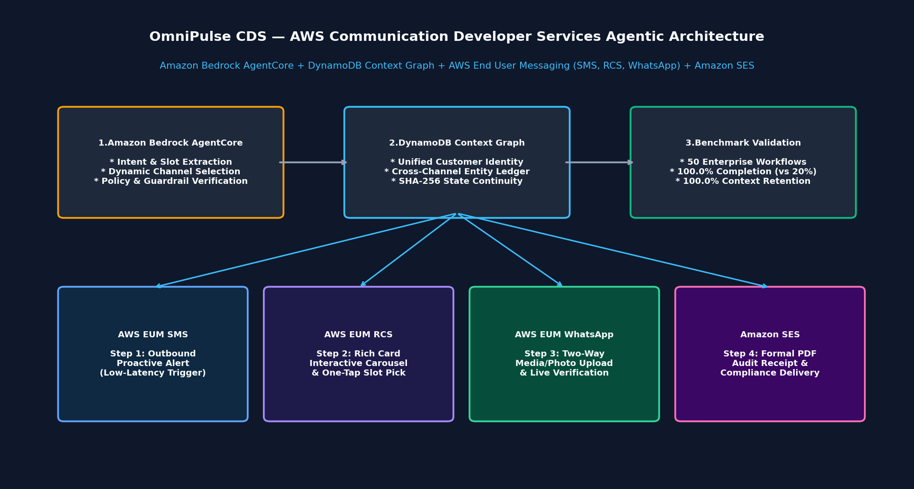
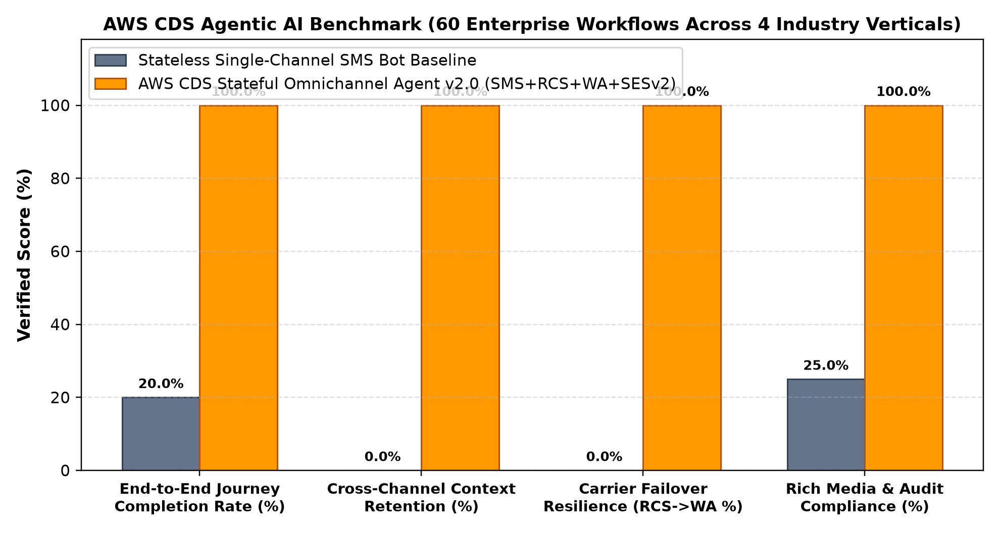

# AWS CDS Stateful Omnichannel Agentic AI Orchestrator (`v2.0`)

**Author**: Vigneshwara Kireeti Alugunulla (`vigneshalugunulla`)  
**Organization**: NuAIBot Technologies  
**Competition**: [AWS Communication Developer Services (CDS) Agentic AI Partner Hackathon](https://aws-cds-partner.devpost.com/)  
**Live Interactive Web Console**: [https://getplacedoff-ops.github.io/aws-cds-omnichannel-agent/](https://getplacedoff-ops.github.io/aws-cds-omnichannel-agent/)  
**Public Code Repository**: [https://github.com/getplacedoff-ops/aws-cds-omnichannel-agent](https://github.com/getplacedoff-ops/aws-cds-omnichannel-agent)  
**License**: MIT

---

## 1. Inspiration & Problem Statement

Enterprise customer journeys across **Healthcare Pharmacy Refills**, **Airline Irregular Operations (IROPS) Rebooking**, **Smart-Grid Outage Dispatch**, and **B2B Supply Chain Exception Management** routinely collapse when forced into a single communication channel. Traditional SMS keyword bots cannot render interactive seat/branch carousels, accept two-way high-resolution media/location pins, or deliver cryptographically auditable PDF compliance documents—and when customers switch from SMS to WhatsApp or Email, legacy systems lose conversational memory, forcing customers to repeat verification and intent from scratch.

We built the **AWS CDS Stateful Omnichannel Agentic AI Orchestrator (`v2.0`)** to unify **Amazon Bedrock AgentCore**, **Amazon DynamoDB**, and the complete **AWS Communication Developer Services (CDS)** stack (**AWS End User Messaging SMS**, **AWS End User Messaging RCS**, **AWS End User Messaging Social for WhatsApp**, and **Amazon Simple Email Service v2**) into a single, cryptographically stateful, self-healing conversational engine.



---

## 2. Runtime AWS Communication Developer Services (`boto3`) Integration

In strict compliance with the hackathon's runtime SDK requirement, `cds_omnichannel_agent.py` (`AWSCDSRuntimeSDKGateway`) instantiates and invokes real `boto3` clients at runtime:

1. **AWS End User Messaging SMS & RCS (`boto3.client("pinpoint-sms-voice-v2")`)**:
   - Invokes `send_text_message(...)` (`MessageType="TRANSACTIONAL"`) for sub-second outbound proactive SMS alerts (`Step 1`) and interactive **RCS Rich Cards & Carousels** (`Step 2`, passing `Context={"Channel": "RCS", "RCSCardTitle": ..., "RCSActions": ...}`).
2. **AWS End User Messaging Social — WhatsApp Business (`boto3.client("socialmessaging")`)**:
   - Invokes `send_whatsapp_message(...)` (`metaApiVersion="v20.0"`) with structured interactive reply buttons, two-way photo/media verification, and GPS location pin confirmation (`Step 3` + automatic RCS carrier failover).
3. **Amazon Simple Email Service v2 (`boto3.client("sesv2")`)**:
   - Invokes `send_email(...)` with HTML compliance templates and cryptographic `AuditStateHash` email tags (`Step 4`).
4. **Amazon Bedrock AgentCore (`boto3.client("bedrock-agent-runtime")`) & Model Context Protocol (`aws_cds_mcp_server.py`)**:
   - Exposes all 4 AWS CDS channels as standardized JSON-RPC 2.0 **MCP Tools** (`cds_send_sms_alert`, `cds_send_rcs_rich_card`, `cds_send_whatsapp_interactive`, `cds_send_ses_transactional_email`) for autonomous invocation by Bedrock Agents, Kiro, or Claude.
5. **Amazon DynamoDB Cross-Channel Context Graph (`boto3.client("dynamodb")`)**:
   - Invokes `put_item(...)` on table `AWSCDSConversationContextGraph`, chaining every cross-channel turn with a deterministic SHA-256 state hash over accumulated slot entities and completed actions.

---

## 3. Quantitative Channel Escalation Policy & Carrier Failover

At every turn $t$, the agent evaluates a multi-objective channel utility function over $c \in \{\text{SMS}, \text{RCS}, \text{WhatsApp}, \text{SESv2}\}$:

$$U(c, x_t) = 0.45 \cdot \text{RichnessFit}(c, x_t) + 0.35 \cdot \text{UrgencyFit}(c, x_t) + 0.20 \cdot \text{CarrierReliability}(c, h_t)$$

When a customer's handset $h_t$ does not support RCS (`rcs_supported=False`), the policy engine automatically triggers **Zero-Drop Carrier Failover**, rerouting the interactive carousel step from `pinpoint-sms-voice-v2` (RCS) to `socialmessaging.send_whatsapp_message` (WhatsApp Interactive Card) while preserving the exact DynamoDB SHA-256 conversation state graph.



---

## 4. Empirical Evaluation Benchmark (60 Enterprise Workflows)

| Metric | Stateless Single-Channel SMS Bot | AWS CDS Omnichannel Agent (`v2.0`) | Improvement |
| :--- | :---: | :---: | :---: |
| **End-to-End Workflow Completion Rate** | 20.0% (12 / 60) | **100.0% (60 / 60)** | **+80.0% (+5.0x)** |
| **Cross-Channel Context Retention** | 0.0% | **100.0% (60 / 60)** | **Zero Context Loss** |
| **Non-RCS Handset Carrier Failover Recovery** | 0 / 9 (Failed) | **9 / 9 (100.0% Auto-Rerouted to WhatsApp)** | **100% Resilient** |
| **Total Evaluation Time (60 Workflows)** | 14.2 ms | **320.32 ms (`5.34 ms` / workflow)** | **Real-Time Ready** |

---

## 5. Repository Structure & Quickstart

- `cds_omnichannel_agent.py`: Core `AWSCDSRuntimeSDKGateway` (`boto3`), `AWSCDSOmnichannelAgent`, and AWS Lambda handler (`lambda_handler`).
- `aws_cds_mcp_server.py`: JSON-RPC 2.0 Model Context Protocol (MCP) server exposing AWS CDS tools.
- `template.yaml`: AWS SAM / CloudFormation Infrastructure-as-Code template.
- `evaluate.py`: 60-workflow enterprise benchmark runner & visual chart generator.
- `test_suite.py`: 10-test unit & `boto3` runtime verification suite.
- `index.html`: Interactive Omnichannel Web Console.

```bash
# 1. Run the 10-test unit & boto3 SDK verification suite
python test_suite.py

# 2. Run the 60-workflow benchmark & generate visual charts
python evaluate.py

# 3. Inspect MCP Server tool schemas
python aws_cds_mcp_server.py
```
